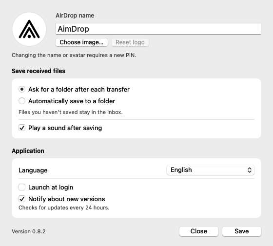

<p align="center">
  
</p>

# AimDrop

**Receive AirDrop files on your Mac. Choose where they go.**

AimDrop lives in the macOS menu bar and appears as a receiver in AirDrop on your
other Apple devices, including iPhone, iPad and Mac. Files arrive in a persistent
inbox before you choose a destination, so dismissing the folder picker never
discards a transfer.

**[Download for Apple Silicon](https://github.com/emiterkamieni/AimDrop/releases/latest)**
 · [Releases](https://github.com/emiterkamieni/AimDrop/releases)
 · [Report an issue](https://github.com/emiterkamieni/AimDrop/issues)

**Latest release: [0.8.5](https://github.com/emiterkamieni/AimDrop/releases/tag/v0.8.5) (build 25)**
— automatic hiding from the receiver Mac's own AirDrop, remote discovery over
AWDL and automatic visibility recovery. See [what changed](docs/releases/0.8.5.md).

## Features

- **Visible to your other devices.** AimDrop automatically stays out of its own Mac's system AirDrop.
- **Automatic discovery recovery** after Wi-Fi/AWDL interruptions, address changes or wake, with access to your inbox while visibility is being restored.
- **Choose a folder after receiving**, or automatically save new transfers to a selected folder.
- **A durable inbox.** Unsaved files survive closing the picker and restarting the app.
- **Live progress:** a blue progress bar, received bytes, file counts, and cancellation.
- **Unsaved transfers:** access every waiting batch from the menu, view up to ten file/folder names, and save or delete each transfer separately. **Delete All** moves the currently available batches to Trash after one confirmation.
- **Hover previews:** point at a file name for an image, document thumbnail, video frame or text excerpt. Preview availability for document/video formats depends on macOS Quick Look and installed codecs.
- **Automatic inbox cleanup:** unsaved transfers move to Trash after 7 days by default, with an adjustable period and an off switch.
- **Your receiver identity:** choose a name and an avatar, with circular cropping and zoom.
- **Remembered PIN pairing** with a fresh PIN when you change the receiver name or avatar.
- **Launch at login**, enabled by default on first launch for new installations and managed through macOS login items.
- **15 languages**, selected automatically from your system preferences or manually in Settings.
- **In-app updates** through Sparkle, with signed downloads, safe restart, 24-hour checks and optional new-version notifications.



## Requirements

- An **Apple Silicon Mac running macOS 26 or later**.
- A sending Apple device with AirDrop, such as an iPhone, iPad or another Mac.
- Local-network access enabled for AimDrop.

Device interoperability has been verified with an iPhone running **iOS 26.6.1**
and a receiving Mac running **macOS 26.5.2**.
See the [0.8.5 validation status](docs/releases/0.8.5.md#validation-status) for the
scope of device testing of the new discovery implementation.

Release ZIPs include their own Python runtime. Python, Homebrew and developer
tools are needed only when building from source.

## Install

1. Download the latest `AimDrop-…-macos-arm64.zip` from [Releases](https://github.com/emiterkamieni/AimDrop/releases/latest).
2. Extract it and move **AimDrop.app** to **Applications**.
3. Open AimDrop and allow local-network access and notifications.
4. **Launch at login** is enabled by default for new installations. To disable it, change the option in Settings and click **Save**.

Current releases are ad-hoc signed. If macOS blocks the first launch, use
**System Settings → Privacy & Security → Open Anyway** for AimDrop.
See [distribution details](docs/distribution.md) for checksums, signing and release builds.

## Receive your first transfer

1. On the sending Apple device, select files and choose **Share → AirDrop → AimDrop**,
   or use **AirDrop** in Finder on a Mac.
2. Enter the PIN shown on your Mac when pairing for the first time.
3. Follow the transfer in the progress panel.
4. Choose a destination and click **Save here**.

If you cancel the folder picker, the files stay in AimDrop's inbox. Open
**Unsaved transfers (N)** in the menu and choose **Save** on any batch, or use its
received-files notification. Each batch shows its item count, receipt date, file
names and availability deadline. After saving, its buffer is removed and the
completion panel offers **Show in Finder** and **Open**.

**Delete** moves the entire unsaved batch to Trash after confirmation. Automatic
cleanup does the same after **7 days** by default. Change the number of days or
turn cleanup off in Settings, then click **Save**. A new period applies only to
future transfers; existing deadlines survive restarts. Turning cleanup off pauses
it without resetting deadlines, so overdue batches can move to Trash when it is
enabled again. Existing batches from older versions get a full grace period on
their first launch with this feature.

**Delete All**, at the bottom of the transfer list, applies to the batches present
when you click it. Transfers being saved and later arrivals are excluded. Hover
over a file name for a lightweight preview; GIFs and videos use a static frame.
PNG, JPG, HEIC, GIF and WebP images use native image decoding; PDF, DOC/DOCX,
MOV, MP4 and WebM use Quick Look when available. TXT shows a bounded text excerpt.

Cleanup runs while AimDrop is open and checks again after launch or wake. Batches
being saved or having their destination selected are protected. Files moved to
Trash continue to occupy disk space until Trash is emptied.

Changing the receiver name or avatar requires a new PIN. After pairing,
**close and reopen AirDrop on the sending device** to refresh the displayed name and image.
Ordinary application restarts preserve pairing.

### Receiver visibility

AimDrop advertises to nearby devices over Apple's AWDL Wi-Fi link. It automatically
stays out of the system AirDrop picker on the Mac running AimDrop; no setting is needed.

If AWDL is unavailable, the menu shows **Waiting for Wi-Fi…**. AimDrop automatically
rebuilds discovery after AWDL disappears, its address changes, an advertisement
cannot be sent, or the Mac wakes. **Restoring receiver visibility…** indicates that
recovery is in progress. Already-received files remain accessible through
**Unsaved transfers**, including saving and moving them to Trash, while discovery
is unavailable.

## Languages

AimDrop supports English, Polish, German, French, Spanish, Italian, Portuguese,
Dutch, Swedish, Czech, Ukrainian, Japanese, Korean, Simplified Chinese, and
Traditional Chinese.

**System default** follows the first supported language in your macOS preferences,
with English as the fallback. A manual choice in Settings takes effect after **Save**.
Receiver names and file names are preserved exactly as entered or received.

## Update AimDrop

**Already using 0.8.4 or another build with the in-app updater (including the local 0.8.3 build)?**
Open the menu-bar icon → **Check for Updates…** → **Update and Restart**.
AimDrop downloads and installs the newer release and then reopens itself.

**Upgrading from the public 0.8.2 release or earlier?** Download and install
the latest release once using the [installation steps](#install). **0.8.4 was the
first public release with the built-in installer**; subsequent releases can be
installed from the app.

Upgrading to **0.8.5 (build 25)** preserves stored pairing, receiver name, avatar,
settings and inbox files. The upgrade alone does not require a new PIN; changing
the receiver name or avatar still does.

AimDrop checks the latest stable release in this repository every 24 hours,
including across application restarts. Select **Check for Updates…** in the menu
to check immediately. Enable or disable **Notify about new versions** in Settings
and click **Save**. Notifications are enabled by default and include a **Show Update**
button that opens AimDrop's update window. This preference controls new-version
notifications; scheduled checks, manual results and file-transfer notifications
continue to work.

Click **Update and Restart** to download, verify and install the update. AimDrop
waits for accepted transfers, saves, Trash operations and an already-open folder
picker. New operations are blocked during restart preparation. Unsaved settings
can be saved, discarded, or used to cancel the update; a save error stops restart.
Ready, unsaved transfers remain in the durable inbox. Sparkle replaces the exact
running copy, including a copy in `dist`, then relaunches it.

Both the ZIP and update feed are signed with Ed25519. The app remains ad-hoc
signed; these update signatures are separate from Apple's Gatekeeper approval.
Only the release publisher uses the private signing key. Checking or installing
updates never asks end users for access to a Sparkle signing key in Keychain.

Outbound firewalls such as LuLu must allow HTTPS connections to `github.com` and
its release-asset CDN for update checks/downloads.

Transfers stay local. Update checks contact GitHub; files are never uploaded to
GitHub or relayed through a cloud service.

## Build from source

Use an Apple Silicon Mac with macOS 26, Xcode Command Line Tools, and Python 3.9+.
Quit an existing AimDrop instance before running a development build.

```sh
git clone https://github.com/emiterkamieni/AimDrop.git
cd AimDrop
python3 scripts/build.py
open dist/AimDrop.app
```

Create a portable ZIP with the pinned, bundled Python runtime:

```sh
python3 scripts/package.py
```

The packager verifies the runtime download, includes its licenses, signs the
bundle, and checks the extracted archive from a different location.

To prepare a release that can also be installed through AimDrop, sign the final
ZIP and update feed using the release publisher's Keychain key:

```sh
python3 -B scripts/prepare-update.py --version 0.8.5 --notes docs/releases/0.8.5.md
```

Upload **all three** outputs from `dist` to the same GitHub release:
`AimDrop-0.8.5-macos-arm64.zip`, `appcast.xml`, and `SHA256SUMS`. Publish them
together and mark the release as **Latest**, so the stable update-feed URL points
to it. Both the version and build number must increase for future releases.
Use `--archive-only` when preparing a newer release while the current
`dist/AimDrop.app` is running; that copy can then update itself from the published
release. See [the release guide](docs/distribution.md).

### Checks

```sh
python3 -B -m unittest discover -s tests
python3 scripts/check-swift.py --app dist/AimDrop.app
python3 scripts/smoke.py --app dist/AimDrop.app

# Native PIN / PairVerify / HTTP3 integration with isolated test state
python3 scripts/research/build-pairing-prototypes.py
python3 scripts/native-smoke.py --app dist/AimDrop.app
python3 scripts/check-native-update.py --app dist/AimDrop.app
```

The Swift UI checks need a logged-in macOS desktop session.

## Project layout

| Directory | Purpose |
| --- | --- |
| `Sources/` | AppKit interface, settings, localization, notifications, and updates |
| `NativeReceiver/` | Headless native AirDrop transport entry point |
| `NativeInbox/` | Native helper for moving unsaved transfers to the macOS Trash |
| `receiver/` | Python worker, persistent inbox, archive handling, and saving |
| `Resources/Localizations/` | Complete language catalogs shared by the app and worker |
| `scripts/` | Build, packaging, artwork generation, and integration tools |
| `scripts/research/` | Shared native protocol implementation and interoperability probes |
| `tests/` | Model, UI, localization, update, and receiver checks |
| `docs/` | Artwork, architecture, translation and distribution documentation |
| `docs/research/` | Historical implementation and device-test notes |

Build products and caches are ignored by Git. Application data is stored in
`~/Library/Application Support/AirFrajer/`; that historical directory and bundle
identifier are retained to preserve existing inboxes and pairing state.

## License

[GPL-3.0-only](LICENSE). Research sources, artwork attribution and bundled-runtime
notices are documented in [THIRD_PARTY.md](THIRD_PARTY.md).
